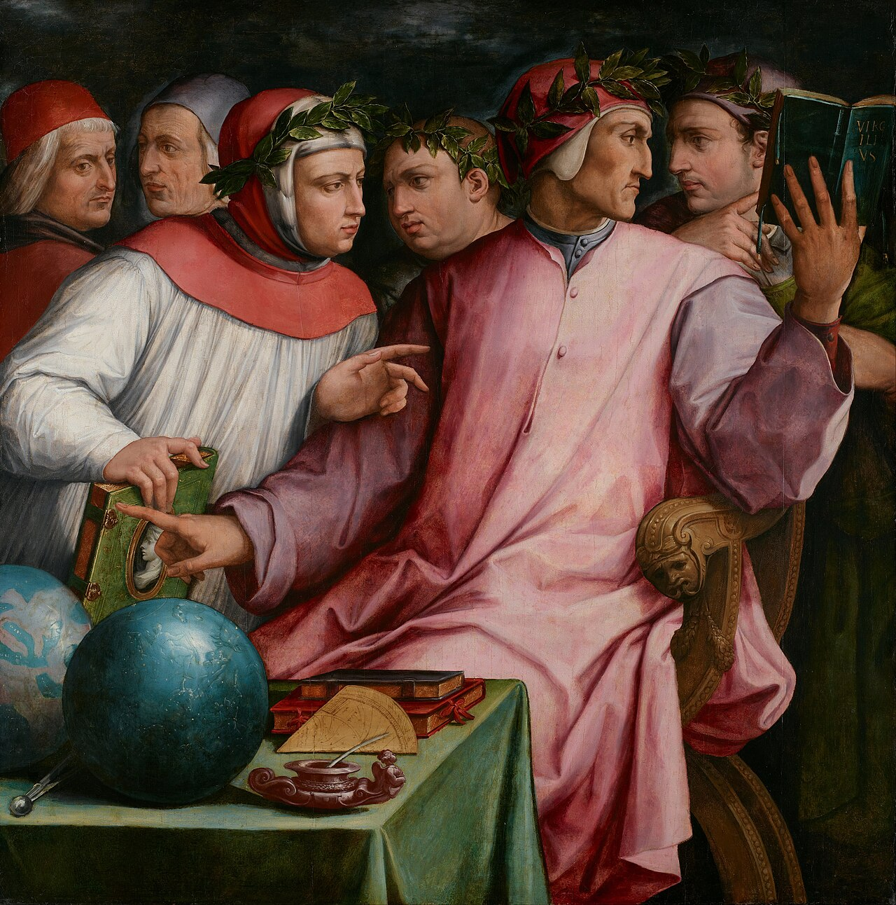

Research group based in Cape Town focused on natural language generation (NLG) for African languages, with a particular emphasis on low-resourced Southern African languages.

<figure>
  
  <figcaption><em>Six Tuscan Poets</em>, Giorgio Vasari (1544). Public domain, via Wikimedia Commons.</figcaption>
</figure>

## Focus areas

- Natural language generation for low-resourced African languages
- Controlled natural languages
- Computational morphology, noun classification, and other tasks for African languages
- Knowledge engineering and ontology verbalisation
- Human evaluation of auto. generated text

## Members

- [Zola Mahlaza](/): Leader

## Postgraduate students

- [Tadiwa Magwenzi](https://uk.linkedin.com/in/tadiwa-magwenzi) (MSc. CS)
- [Masixole Nkumbesi](https://za.linkedin.com/in/masixole-nkumbesi) (MPhil. Inclusive Innovation)
- Dennis Kiptanui Too (PhD. CS)
- Atshilaho Nethathe (PhD. CS)
- [Daniel Holgate](https://za.linkedin.com/in/daniel-holgate) (Msc. CS)
- [Nana kwabena Opoku-Acheampong](https://za.linkedin.com/in/nana-kwabena-opoku-acheampong-623981237) (Msc. AI)
- [Lindani Buthelezi](https://za.linkedin.com/in/lindani-buthelezi) (M.IT)

## Alumni

- [Katlego Makhubedu](https://za.linkedin.com/in/katlego-makhubedu): On linguistically-motivated approaches for noun classification
- Génevieve Rachel Chikwanha: On LLMs for Afrikaaps
- [Dylan Saayman, Connor Paton, Dean Sneddon](https://projects.cs.uct.ac.za/honsproj/cgi-bin/view/2026/paton_saayman_sneddon.zip/): On Large Language Models to African Languages
- Phuthang Makhupane (MSc. AI). 2026: Thesis: Developing Metrics to Measure the Bootstrapping Potential of NLP Resources between NCB Languages
- Mandikudza Dangwa, Emma Van Der Berg, and Rector Ratsaka (Honours. 2025. On: Controlled Natural languages and models for research question authoring, scoring, and improvement)
- Alexander van der Leek, Jonathan Mopp (Honours. 2024. On: Comparing the utility of morphosyntactical data vs. semantics for noun classification)
- Liam Talberg and Adam Vere (Honours. 2023. On: Comparing pre-trained models to template-based methods for automatic question generation)
- Danny Guttman and Mandisa Tunzi (Honours. 2023. On: Improving Text-Based Programming Error Messages For South African Students)
- Amy Solomons and Junior Moraba (Honours. 2021. On: Digital Assistant for Financial Transactions)
- Shannon Smith (Honours. 2020. On: Generating isiZulu text from Mathematical expressions)
- Jarryd Dunn and Matthew Poulter (Honours. 2019. On: A comparison of end-to-end models and templates for generating text)

## Publications

Work associated with CapeNLG members can be found on the [publications](/publications/) page.
